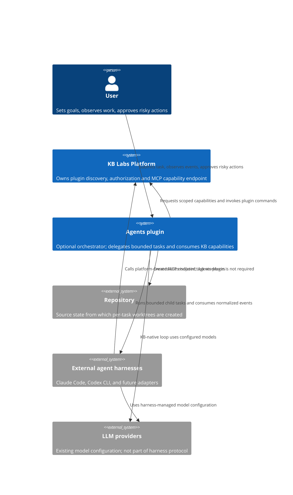
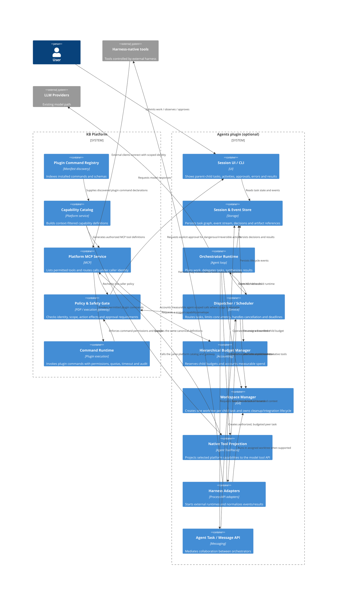
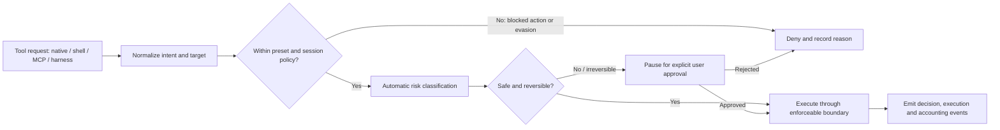

# Multi-agent orchestration architecture

**Status:** Working design; the scoped-MCP lease slice is implemented in the workspace, broader catalog/policy work remains
**Scope:** KB-native agents, external harnesses, tool access, safety policy, budgets, and future agent-to-agent coordination.

This document captures the target direction for scaling from one orchestrator with
sub-agents to multiple cooperating orchestrators. It separates current behavior
from future capabilities so that new transports and execution locations do not
become entangled with harness adapters.

## Design decisions so far

1. A preset is the baseline policy and the maximum authority envelope for an
   agent. It is not, by itself, the final decision for every operation.
2. Automatic safety checking applies to actions, not merely tool names. It must
   detect dangerous intent and attempts to bypass a blocked tool using shell,
   scripts, MCP, or another equivalent path. Dangerous or irreversible actions
   require explicit user approval; known policy violations and evasions are
   denied.
3. Each child task gets its own Git worktree. A worktree isolates repository
   changes from sibling tasks, but is not a general security sandbox and does
   not prevent network or credential access.
4. LLM providers and model selection remain in the existing LLM configuration.
   Harnesses are agent runtimes, not model providers.
5. Future execution locations (worktree, container, remote worker) are a
   separate axis from harness and tool transport.

## C1 — System context



## C2 — Containers and trust boundaries



The gateway and policy service are logical boundaries; they may be packages in
one process initially. The key invariant is that every action that claims KB
policy enforcement passes through an enforcement point. A tool that bypasses
that point must be explicitly marked as a weaker guarantee.

## Policy and automatic safety checking

The preset defines a baseline capability ceiling. The safety gate then
evaluates the requested action and context, regardless of the surface used to
express it:



The classifier must reason about the effect, not only the tool name. For
example, if direct file writes are outside the preset, writing through a shell
script is still a write. Existing scripts should be inspected where feasible;
dynamic scripts, subprocesses, obfuscation, network calls, and environment
credentials require execution-level restrictions as well as classification.
The classifier is a safety layer, not a substitute for OS/container
confinement. It must fail closed for actions known to violate policy, and
surface uncertain high-impact actions for user approval rather than treating
uncertainty as permission.

An approval is an explicit, attributable event bound to the exact action,
target, child task, and policy context. Any material change to that action
invalidates the approval. With many parallel agents, approvals should be
queued centrally, cancellable, and visible in the parent session; one agent's
approval must not authorize another agent's action.

## Budgets and concurrency

Budgets are hierarchical and independent of capability policy:

- The parent reserves a bounded share of its remaining budget for each child.
- A child cannot delegate more than its own remaining allocation.
- Measured token/cost usage is settled against the reservation. External
  harness usage may be unknown; unknown is not zero and must be shown as such.
- Wall-clock deadline, maximum active children, queue depth, and cancellation
  are separate limits from tokens/cost.
- Retries need idempotency and must not silently create a new budget envelope.

For 10–20 concurrent agents, the dispatcher should own admission control and
backpressure. A parent should receive bounded summaries and artifact
references, not every full child transcript. Events remain streamed and
correlated by session, parent task, child task, and activity ID.

## Tools and MCP

Capabilities are semantic (for example, workspace read/write, shell execution,
memory access, or user interaction); transport names are not capabilities.
The platform gateway maps authorized capabilities to concrete implementations.
Agent-local control tools (such as task submission) may remain in the Agents
plugin; capabilities backed by platform/plugin commands go through the
platform-owned catalog and gateway. MCP is a projection over that same catalog,
not a separate inventory or policy source; it must carry session/task identity
and scoped authorization context. Exposing an MCP endpoint alone does not
enforce the KB policy.

### Unified Tool Catalog and lazy discovery

The platform already owns the MCP service and has a command registry. Making
the platform the source of available capabilities avoids physical coupling to
the Agents plugin and lets external clients use KB capabilities without
installing it. Keep the dependency direction explicit:

| Owner | Responsibility |
| --- | --- |
| KB platform | Canonical capability definitions, plugin/command discovery, caller-bound authorization, invocation, audit, approval enforcement, and MCP projection. No LLM loop or agent orchestration. |
| Plugin | Declares and implements capabilities/commands, schemas, effects, and owning permissions. It need not know whether the caller is an agent or MCP client. |
| Agents plugin | Requests a bounded capability envelope for a child execution, consumes platform capabilities, supplies agent-specific presets/context, and renders selected capabilities as native model tools. No duplicate command registry. |
| External harness | Consumes the platform MCP endpoint under its own scoped identity; does not require the Agents plugin. |

Use the platform-owned canonical catalog as the source for both projections:
native model-tool definitions and the MCP interface. Each
catalog entry needs a stable ID, category, description, input schema, semantic
capabilities, side-effect/risk metadata, availability conditions, and an
invoker reference. The catalog stores definitions; the gateway resolves the
invoker and rechecks live policy at execution time. Do not maintain separate
hand-written allowlists for native tools and MCP.

Populate the catalog from native platform/plugin tool declarations, plugin
CLI commands, and configured MCP tool providers admitted under an explicit
owner and policy. The existing registry already extracts `cli-command`
entities, and the MCP service already builds callable tool definitions from
command manifests. Reuse that path rather than creating a parallel inventory.
Existing command flags seed input schemas; `operationType` and command
permissions seed coarse effect metadata. If this is insufficient, extend the
generic plugin capability contract at the platform boundary (typed
input/effects/required permissions), not with a dependency on Agents.
Underspecified commands must not silently inherit broad permissions.

Each execution receives a small default surface (configurable X; start around
8–10 useful tools plus discovery) and `find_tool`. Search results are filtered
by the current caller's policy before names or schemas are revealed. A
discovered tool can be invoked through generic
`invoke_tool(toolId, arguments)`, or projected as a typed tool on the next
model turn; both resolve against the same catalog and revalidate schema and
authorization at execution time. MCP should follow the same lazy-discovery
contract rather than dump every installed command into `tools/list` by default.

Plugin commands need a first-class invocation route, not `shell_exec("kb …")`.
The platform MCP router already executes manifest commands through the normal
`executeCommandV3` pipeline and rechecks authorization on calls. Preserve that
path so command permissions, timeout, cancellation, output limits, and audit
context remain attached. Add scoped execution identity/task context and
capability-level policy there; `read`/`analyze`/`mutate`/`execute` labels are
useful initial hints, not a substitute for capabilities or safety checks.

This closes the gap where a plugin command exists but is not available to an
agent. A plugin declares an operation once; the platform generates CLI,
agent-tool, and MCP surfaces while keeping interactive-only or unsafe
commands out of a caller's visible set unless authorized.

#### Existing platform MCP implementation

The repository already has much of this path in `services/mcp`: it builds MCP
tools from installed plugin command manifests, filters `tools/list` per
authenticated identity, rechecks authorization on `tools/call`, and invokes
commands through the regular `executeCommandV3` pipeline. The listing cache is
per identity and is not the authority for execution. This is a strong base,
not yet the complete target:

- Authorization currently maps command `operationType` to coarse `mcp.read` /
  `mcp.write`; the authz seam documents a permit-all PDP stub as its default.
- The MCP list currently returns every command permitted to that identity;
  default-X exposure and `find_tool` lazy discovery are still needed.
- The service catalogs CLI commands, not the Agents plugin's internal native
  ToolPacks and task-control tools. Those need platform registration/contracts
  before both surfaces can come from one catalog.
- An agent child needs a platform-issued, session/task-scoped authorization
  context. A caller-provided preset string must not itself grant authority.

### User maximum and delegated agent profiles

The platform authorization for a user is the maximum boundary, not the exact
set every agent must receive. A user may delegate a narrower profile to an
agent for a task. Resolve effective authority by intersection:

```text
effective lease = user maximum
                ∩ organization/project policy
                ∩ user-selected agent profile
                ∩ parent task lease
                ∩ task resource and execution-environment scope
```

Every child lease is a subset of its parent's lease; delegation cannot add
rights. Agent preset (research/review/execute) controls behavior and default
tool selection, while an access profile controls authority. Keep those
concepts separate.

An access profile should describe structured resources and actions, not just a
tool allowlist: resource selectors (for example, `environment=production` or
`server-group=deploy`), operations (`connect`, `inspect`, `read-logs`,
`write-files`, `execute-command`, `deploy`), constraints, approval policy,
expiry, and applicable execution locations. For example, a production
diagnostics profile could allow connecting to a named remote server and
reading status/logs while denying file edits, arbitrary commands, deployment,
and secret reads. “Can connect” must not implicitly mean “has a shell.”

The platform issues an opaque execution lease (or equivalent signed,
revocable capability) bound to user, agent execution, task, resources, and
expiry. Prefer a server-side lease ID where immediate revocation, audit, and
single-use approvals matter. Agents and external harnesses receive only this
scoped credential, never the user's broad bearer token or raw connector
credentials. MCP listing filters by the lease; every call validates the live
lease again. Budget reservations and capability authority remain independent:
a valid lease does not grant more budget, and budget does not grant more
authority.

For remote access, logical policy needs enforcement at the actual boundary:
scoped remote credentials, restricted OS account, read-only mounts, command
allowlists, and/or network egress controls. A model classifier is an additional
safety gate, not proof that remote side effects are impossible. Approval may
authorize a specific action only if the user maximum permits it; approval
cannot override an explicit deny or widen the lease.

### Implementation path

Build this as vertical slices, reusing `services/mcp` rather than creating a
second MCP server or a parallel command inventory:

1. **Capability contract:** add stable capability IDs, resource/action scope,
   input schema, effect class, owner, and invocation reference. Keep agent
   presets separate from access profiles. Existing manifest commands can be
   the first provider; internal Agent orchestration controls remain local until
   explicitly registered.
2. **Scoped lease:** have the platform issue a task-bound lease from the
   intersection above. Test expiry, revocation, resource scope, and the
   invariant that child leases can only narrow parent authority. Start with an
   opaque server-side lease ID; do not pass the user's broad token to agents.
3. **MCP enforcement and discovery:** filter `tools/list` by the live lease,
   expose a small default set plus `find_tool`, and validate schema and policy
   again on every call. Add exact-action approval records for risky operations.
4. **First vertical slice:** allow an agent to read status/logs for one
   explicitly selected remote server while proving that file edits, arbitrary
   shell commands, deploys, other servers, and secrets are denied. Run the same
   test via an Agents MCP client and a direct external MCP client.
5. **Broaden providers:** register native ToolPacks as platform capability
   providers so native Agents and external harnesses see the same catalog.
   Add other plugin command classes only after their schemas/effects and denied
   paths are tested.
6. **Safety and operations:** add classifier/approval behavior, audit events,
   per-call quotas, cancellation, policy-version-aware listing cache, and
   concurrent lease tests before enabling broader remote write or deployment
   profiles.

The current MCP path already covers manifest-command discovery and invocation;
steps 1–3 are the enabling platform work. A remote read-only profile is a
useful first proving case, not a commitment that remote execution or
deployment is already supported.

#### Implemented local integration slice: external harness MCP lease

`services/mcp` now has `POST /api/v1/mcp/leases`. In local testing only, an
explicit development PDP stub can mint a child lease without a user bearer;
that stub identity is deliberately granted every MCP command. This is the
temporary integration point while the real caller identity / token bootstrap
is designed separately. Never enable it in a shared or production environment.

Agents can request exact MCP tool IDs (or `"*"` for every tool authorized by
the active PDP) when submitting an external Claude Code or Codex CLI child.
The service returns an opaque short-lived child bearer; only its SHA-256 key
and scoped record are stored in cache. The default lifetime is 10 minutes and
the maximum is one hour. Child leases cannot add tools or remove/alter an
inherited input constraint, and cannot outlive their parent. A lease bearer
sees only its tool allowlist; calls recheck current policy, lease expiry, tool
allowlist, and exact constrained input values. The child lease is revoked when
the harness exits (and expires if cleanup cannot reach the service).

For local manual testing, configure the Agents plugin with:

```json
{
  "agents": {
    "platformMcp": {
      "endpoint": "http://127.0.0.1:7779/api/v1/mcp",
      "developmentPdpStub": true
    }
  }
}
```

Start the MCP daemon with `KB_MCP_AGENT_LEASE_PDP_STUB=allow-all` and a
non-production `NODE_ENV`. Both opt-ins are required. On `task_submit`, specify
an external `harness` and `mcpTools`, e.g. `mcpTools: ["host-agent__workspace_status"]`;
use `mcpInputEquals` to pin resource arguments such as `server: "staging"`.
For the broad local smoke test, use `mcpTools: ["*"]`. Do not put a parent
gateway bearer or MCP token in Agents configuration: the child receives only
the issued scoped lease.

Example request:

```json
{
  "executionId": "task-123",
  "allowedTools": ["host-agent__workspace_status"],
  "inputEquals": { "host-agent__workspace_status": { "server": "staging" } },
  "ttlSeconds": 300
}
```

Real user token acquisition/forwarding remains intentionally unimplemented
and tracked as a separate design task. Named access profiles, explicit
`mcp.delegate` policy, durable audit, lazy `find_tool` discovery, and the
shared native/MCP capability catalog remain follow-up work. The local
all-authorized stub must not be treated as production authorization. There is
not yet a supported read-only remote-server tool contract, so tests prove
tool/resource scoping generically rather than claiming protection over a
particular remote host.

External harnesses may call their own native tools without going through the
KB gateway. Adapters must declare what is actually enforced, not just what is
observable:

| Enforcement level | Meaning |
| --- | --- |
| `enforced` | KB gateway or execution environment can reliably allow/deny the action. |
| `advisory` | KB can inspect or classify the action but cannot guarantee it can stop it. |
| `unknown` | The adapter cannot provide a reliable account of tool access or enforcement. |

The system must not describe advisory or unknown access as equivalent to the
KB ToolPack. The policy for running an external harness with weaker enforcement
is intentionally an open decision; worktree isolation alone does not resolve
it.

## Worktrees and future execution locations

Each child gets a distinct worktree rooted at a known repository revision.
Sibling agents do not concurrently mutate the same worktree by default. A
parent integrates child changes through an explicit result/review/merge step;
conflicts are surfaced rather than silently overwritten. Worktree cleanup,
retention, and recovery of unmerged results belong to the workspace lifecycle.

Harness, tool transport, and execution location are independent axes:

| Axis | Examples | Responsibility |
| --- | --- | --- |
| Harness | KB-native, Claude Code, Codex CLI | Agent loop and vendor-specific process/protocol behavior |
| Tool transport | In-process ToolPack, MCP, future RPC | How tool calls are delivered and observed |
| Execution location | Local worktree now; container or remote worker later | Filesystem, process, network, credentials, isolation and cleanup |

Container and remote execution are future capabilities. They will need explicit
workspace provisioning, credential boundaries, network policy, artifact
transfer, cancellation, and cleanup contracts. A worktree is not itself a
container or security sandbox.

## Cooperation between orchestrators

Orchestrators should collaborate through a mediated task/message service, not
direct peer-to-peer runtime handles. A request to a colleague is a new
delegation with its own identity, policy decision, budget reservation,
deadline, and event stream. Only bounded context and typed artifact references
cross the boundary by default. The recipient can accept, decline, or ask for
clarification; the requesting orchestrator remains responsible for its parent
task and final synthesis.

The task graph must enforce cycle/depth limits and detect duplicate requests.
Shared mutable session state should not be assumed: messages are explicit,
versioned handoffs. This keeps two orchestration domains from implicitly
sharing credentials, budgets, or authority.

## Open decisions

1. What minimum guarantee is required to launch an external harness whose
   native tools are not all intercepted? Options include denying the launch,
   allowing only in a constrained execution environment, or permitting an
   explicitly weaker advisory mode. Worktree-only should not be treated as
   sufficient protection for production access.
2. Which action classes are always denied, which require explicit approval,
   and which may pass automatically? In particular, define how production
   systems, network access, secrets, irreversible file/database operations,
   and subprocesses are represented in policy.
3. How should child worktree changes be integrated: parent-controlled merge,
   patch/artifact handoff, or a configurable combination?
4. What fairness model should govern global concurrency and budget allocation
   when multiple parent orchestrators compete for capacity?
5. What identity and trust relationship is required before one orchestrator
   may delegate to a peer owned by another workspace/team?

## Related documents

- [External harness sub-agents ADR](../adr/0022-external-harness-subagents.md)
- [Repository diagnostics and tool capabilities ADR](../adr/0021-repository-diagnostics-and-tool-capabilities.md)
- [Agent tracing](../AGENT_TRACING.md)
