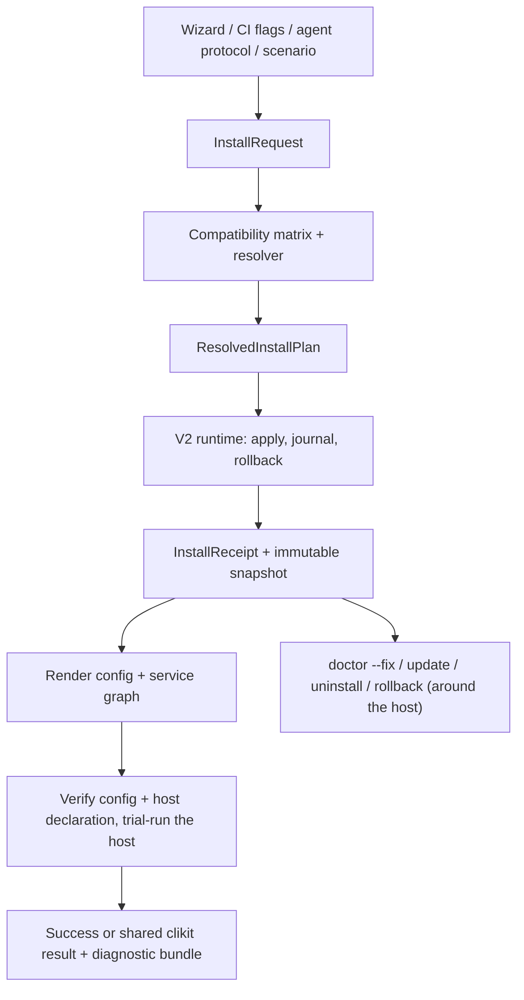

# kb-create V2 — launcher contract reset

**Status:** active public implementation
**Scope:** V2 packages remain under `tools/kb-create/v2/` to keep their import
boundary explicit. The released root binary is `kb-create` and imports only
this V2 command surface; V2 does not import legacy launcher state, manifests,
package manager or execution engine.

## Implemented vertical slice

The V2 boundary is executable and covered by an offline journey test:

- `catalog/` is the deliberately small immutable release index used before
  installation. It resolves the platform bundle, declared compatibility and
  capability providers without scanning an installation.
- `resolve/` emits the immutable `ResolvedInstallPlan` and fails on missing or
  ambiguous providers instead of selecting one by iteration order.
- `render/` projects that plan into the generated runtime config
  `kb.config.jsonc` (including the host's own `host` section), with atomic
  writes. There is no service-manager file: the platform runs as one host
  process.
- `verify/` checks the generated config and the plan's host declaration before
  a receipt is committed; a trial run of the host (`host.Prober`) proves that it
  really starts.
- `artifacts/`, `runtime/`, `receipt/`, `doctor/` and `diagnostics/` establish
  exact artifact application, recovery, manifest-gap
  reporting and redacted dossiers before CLI cutover exposes the flow.
- `cmd/kb-create-v2/` is the root binary's machine frontend: `plan`,
  `apply`, `update`, `uninstall`, explicit `rollback`, and manifest-aware
  `doctor` all use V2 contracts and emit one JSON envelope.

There is no legacy `install` fallback. Connecting two resolvers or lifecycle
owners to one production command would recreate the split-brain V2 removes.

`apply` and `update` require an immutable release index and request. Recovery
operations deliberately require only `--platform-root` (and a snapshot for
rollback), so they recover the verified V2 receipt rather than recalculating a
new plan. Operation logs and raw package-manager transcripts are stored under
`installer/logs/`; failed operations add a redacted dossier under
`installer/diagnostics/`. Active versions expose shared runtime history from
`state/logs/` and `state/diagnostics/` through `.kb/logs/` and
`.kb/diagnostics/`.

CI and agents may pass the request file unchanged, or use direct flags such
as `--platform-root`, `--platform-version`/`--platform-channel`,
`--sdk-version`, `--plugins id@version,...`, `--adapters id@version,...`,
`--service-profile`, `--policy`, and `--offline`. Both forms normalize into
the same `InstallRequest` before resolution; flags never build a separate
shell-level install sequence.

A request file can also declare a validated platform Gateway address. For
example, save this as `request.json` (replace `platformRoot` with the isolated
installation directory):

```json
{
  "schema": "kb.create/v2",
  "platform": { "channel": "stable" },
  "serviceProfile": "default",
  "gatewayUrl": "http://127.0.0.1:45100",
  "platformRoot": "/srv/kb-platform"
}
```

Preview and apply the same request with `kb-create plan --input request.json
--index release-index.json` and `kb-create apply --input request.json
--index release-index.json`. `gatewayUrl` must be an HTTP loopback origin with
an explicit port; the resolver derives the host health URL and dependent
service ports from it. It is a platform topology input and does not configure
Marketplace plugin or adapter sources.

For a human, run `kb-create install`. The platform supports exactly one Node.js
major, the latest LTS major declared by the root `package.json` `engines.node`.
On a mismatch, the installer prints the exact command to switch to that major.
It uses the release index saved by `install.sh` and defaults the platform root
to `~/kb-platform`. It gathers scenario answers, resolves and displays the
plan, then applies that plan through the same engine used by CI. Local access
is the default; secured access remains available in the scenario. After
installation, run `cd ~/any-project && kb commit`.

## Scenarios

`scenario/` is the reusable journey layer. A V2 scenario declares only
product axes (profile/plugins/adapters), validated fields, and either a
manifest requirement ID or a provider capability. It has no shell actions,
package specs, arbitrary file writes, or `devservices.yaml` patches.

Use `--scenario <id> --scenario-answers '{"field":"value"}'` with direct
request flags. The scenario compiles into the same `InstallRequest`; resolver
accepts each value only when the selected platform/plugin/adapter manifest
declares that requirement and JSON Pointer. Secret fields become secret-store
references and cannot have a scenario default. The migrated built-ins are
`commit`, `custom`, `explore`, `plugin-author`, and `release`.

Release automation creates the index with `kb-create-release-index --input
manifest-export.json --manifest-root staging-root --output release-index.json`.
The command reads the exact V2 manifests staged with each artifact and replaces
any hand-authored config projection; missing/mismatched manifests fail the
release. It then rejects an index whose channel points outside its platform
set and seals the canonical payload with a digest. `kb-create` verifies that
digest before resolving.

Secret input uses `--secret-env requirement.id=ENV_VAR`, so CI/agents pass a
reference to process environment rather than secret text through argv/JSON.
V2 stores secret values and their bootstrap lifecycle facts together in the
install-root-owned `state/secret-state.json` (0600), exposed to the active
version at `.kb/v2/secret-state.json`; generated config,
receipt, scenario state, logs, diagnostics and telemetry retain only the
manifest requirement or environment variable name. The launcher hands the
private store to the host process as its environment (see Host supervision).

The host receives its secrets by environment variable name, so on every
apply/update the launcher also stores each present secret under the environment variable its
plan patch binds it to, next to the requirement ID (what the launcher verifies
and doctor checks). This holds whatever supplied the value (`--secret-env` or the
install flow). Two secrets bound to one variable must hold the same value or the run
fails instead of letting the last write win.

Scenario field rules that matter to authors:

- A field whose `when` is false is neither required nor emitted, whatever an
  earlier answer left in the state.
- An optional free-text field left blank means "not provided": it is not
  validated and is not emitted, so it never overwrites a component's own
  default with an empty string.
- Validators are `nonEmpty` and `pattern` (Go RE2 in `arg`, optional `message`
  shown instead of the generic failure); an unknown validator or an invalid
  pattern fails when the scenario is loaded.
- A secret field may set `generate`: the interactive install mints a random
  256-bit value when it is left blank (for machine-owned secrets such as a
  token-signing key). `generate` is only valid on secret fields.

The platform bundle can declare OS/architecture-specific launcher binaries;
V2 verifies their SHA-256 and installs them in `.kb/v2/bin`. Author and ops tools
(`kb-dev`, `kb-devkit`, `kb-env`, `kb-deploy`, `kb-monitor`) are not part of a
user installation: the release index never lists them and no launcher command
takes a `kb-dev` path.

## Why V2

The launcher owns one declarative action engine, catalog, journal, recovery
primitives, interactive install, agent protocol and direct CI flow. Installation state is
resolved from the sealed release index and request before any filesystem or
package-manager mutation.

V2 makes one promise: a user, CI job and agent ask for the same installation;
the launcher resolves the same compatible artifacts, applies the same action
DAG, renders the same service graph, and either verifies it or fails with an
actionable recovery path.

## Non-goals

- Do not import or wrap `internal/engine`, legacy manifests, legacy receipts or
  legacy package-manager code. V2 owns application, recovery and artifact
  boundaries directly.
- Do not retain two production install semantics after cutover. Existing
  launcher code is a migration input and temporary compatibility boundary,
  not a permanent second source of truth.
- Do not make network E2E the primary correctness proof. Most V2 coverage
  runs against deterministic offline artifact fixtures; real npm is reserved
  for candidate smoke.

## Target architecture



### One ownership rule

`ResolvedInstallPlan` owns requested platform/SDK/plugins/adapters, exact
artifact versions, config patches, provider bindings, binaries, the platform's
service graph and the host that runs it.
The generated runtime configuration is a rendered output. A package scan
validates declared artifacts; it must never decide which services the user
received merely because a transitive dependency exposes a manifest.

The required post-condition is that the receipt's host starts and answers its
health check; the launcher proves it with a trial run before committing a
receipt and with the real restart after an update.

For the current product horizon, core and official services are one platform
bundle. A selected platform version owns their exact packages, default
profiles and service graph. Services are therefore not independently resolved
versions. An explicit, platform-bundle companion set is the only permitted
exception to a direct user selection.

## Public operation model

All transports compile to the same request and invoke the same operations:

```text
plan → apply → status → verify
update → snapshot → apply → verify | rollback
uninstall → plan → apply → verify
doctor --fix → recovery plan → apply → verify
```

`InstallRequest` supports the same first-class axes everywhere:

- platform exact version or channel: `stable`, `canary`, `experimental`;
- SDK exact version or channel, constrained by the selected platform;
- platform-owned service profile, plugins, independently versioned adapters
  and explicit provider preferences;
- explicit project/platform roots;
- artifact source: online registry or offline fixture;
- scenario ID for a reusable user journey.

Wizard selects valid options from the resolver. CI and agents can submit the
request directly in flags or JSON. Neither may reconstruct a shell sequence.

## Compatibility matrix and resolver

The matrix is evaluated before every network or filesystem side effect. It
answers which combinations of platform/SDK/channel/plugins/adapters/binaries
are valid and yields exact artifacts plus the platform-owned service dependency
graph.
Core and official services ship with the selected platform release; a missing
or inconsistent service manifest is a platform candidate defect, not a
user-resolvable version choice. Invalid requests fail fast with the same error
contract as runtime failures.

Plugins and adapters remain independently versioned. Their manifests
progressively declare supported platform and SDK ranges. Adapters additionally
declare provided capabilities; plugins/services declare required capabilities.
The resolver selects exactly one compatible provider per required capability,
honours explicit provider preferences, and rejects a missing or ambiguous
binding before installation. It may select an unpinned compatible plugin or
adapter version, but it never silently changes an explicit pin:

| Policy | Behaviour |
|---|---|
| `strict` (default for CI/agents) | The selected platform, SDK and binary pair must have an exact relation in the sealed release matrix. Declared plugin/adapter ranges must exactly name the selected versions. |
| `compatible` (interactive install default) | The exact relation or a declared semantic-version range in the sealed matrix/manifest must admit the selected version. Pins are never changed silently. |

Compatibility ranges support exact `major.minor.patch` versions, `*`, `^` and
`~` ranges, comparison operators (`>`, `>=`, `<`, `<=`, `=`), whitespace-AND
comparators, and `||` alternatives. Versions follow SemVer precedence,
including prereleases. This is the complete supported grammar; npm range
features such as partial versions, wildcards inside a version, hyphen ranges,
and comma-separated comparators are rejected when the release index is sealed.
Numeric version and prerelease identifiers must fit an unsigned 64-bit integer.
Prereleases participate in SemVer precedence. The release-index sealer rejects
malformed or out-of-subset ranges and versions.

No intersecting range produces `KB_INSTALL_INCOMPATIBLE_COMPONENTS` before
download or config writes. A missing capability produces
`KB_INSTALL_PROVIDER_UNRESOLVED`; a competing explicit binding produces
`KB_INSTALL_PROVIDER_AMBIGUOUS`. Each error names the selected versions or
providers, the manifest constraint that rejected them and safe alternatives.
A plugin or adapter without a range supplies no component-specific constraint;
the resolver cannot infer compatibility from the absent field. Release authors
must publish explicit ranges before claiming cross-version compatibility.

Updates recheck every plugin and adapter in the active receipt against its
declared platform and SDK ranges before creating a snapshot or changing files.
An incompatible update returns `KB_UPDATE_INCOMPATIBLE` and names the blocking
component and range. `kb-create update` refuses semantic-version downgrades with
`KB_UPDATE_DOWNGRADE_REFUSED`; use `kb-create rollback` to restore a saved
snapshot.

For example, select the canary channel with
`kb-create plan --platform-channel canary --policy compatible --index release-index.json --input request.json --json`.
The receipt records the resolved channel and exact platform version. To return
to the prior installed version, use `kb-create rollback --yes --json`; an
`update` request for a lower version is refused.

The resolver also validates graph completeness before `apply`: required
providers, ports, dependency targets, offline artifacts and mandatory service
metadata must all resolve. No command may claim success with an incomplete
default configuration.

The technical source of truth for configuration variables and service metadata
remains the manifests shipped by platform components, plugins and adapters.
V2 does not turn interactive install into a universal manifest-variable form. The
install chooses product-level axes and profiles; after verified artifacts are
available, manifest-derived required input either receives a safe default or
returns structured `KB_INSTALL_INPUT_REQUIRED` with a human hint and machine
schema. CI/agents supply those values in `InstallRequest` and resume the same
receipt/journal without recomputing a different flow.

### Doctor is manifest-aware configuration diagnosis

`doctor` loads the active receipt, resolves the installed package manifests
for every selected platform component, plugin and adapter, and compares their
declared requirements with the effective generated configuration. It reports
missing values, invalid values, unresolved capabilities and stale bindings as
structured findings — never by treating an absent default as a later runtime
failure.

For each finding it records the manifest owner, config path/key, whether the
value is secret, expected schema/constraint, safe current-state summary and a
recovery action. Secret values are never printed, bundled or sent through
telemetry; the only permitted state is `set`, `missing` or `invalid`.

```text
KB_INSTALL_CONFIG_REQUIRED
Owner: @kb-labs/plugin-x@4.1.0
Requirement: adapters.llm.apiKey (secret)
Current state: missing
Hint: set OPENAI_API_KEY, then run `kb-create apply --index release-index.json --platform-root /path/to/platform --secret-env adapters.llm.apiKey=OPENAI_API_KEY --json`
```

`doctor --fix` must not invent a secret or silently choose between competing
providers. It may render safe manifest defaults, restore a receipt/snapshot,
rebuild derived config and ask a human/agent for required input through the
same `InstallRequest` schema. The subsequent engine run verifies the repaired
configuration, service graph and readiness before updating the receipt.

### Packages declare their own configuration requirements

A service package states package-specific configuration in a
`kb-create.requirements.json` shipped in its tarball (package root or `dist/`).
For adapters, the build emits this artifact from `kb.adapter.manifest` and its
`configSchema`, so credential requirements have one declaration:

```json
{
  "schema": "kb.create.requirements/v1",
  "requirements": [
    { "id": "gateway.access.mode", "path": "/gateway/access/mode", "default": "secured" },
    { "id": "gateway.jwtSecret", "secret": true, "env": "GATEWAY_JWT_SECRET", "services": ["gateway"] }
  ]
}
```

`prepare-release-index.mjs` merges the generated or service-declared requirements into the package's staged
`kb-create.manifest.json`, and `kb-create-release-index` seals them into the
index; the sealed shape is unchanged (`id`, `path`, `default`, `secret`, `env`,
`services`), so launchers that predate this file keep verifying the digest.

- The file is deliberately **not** named `kb-create.manifest.json`: that name is
  treated as a package's *primary* manifest and would hide a service's
  `kb.service/1` graph, dropping the service from the index.
- `default` is a plain JSON value here (`"secured"`, not `"\"secured\""`).
- A malformed file, a missing/duplicate `id`, or a secret without `env` and
  `services` fails the release rather than shipping the package without its
  requirements.
- Requirements are unconditional. "Only when secured" is expressed by the
  scenario (`when` + a field bound to the requirement); the index carries no
  conditional-requirement syntax.

The gateway declares `gateway.access.mode` (`local` | `secured`), the first-admin
identity (`gateway.bootstrap.adminEmail`, `gateway.bootstrap.tenantId`) and the
secrets `gateway.bootstrap.password` and `gateway.jwtSecret`. A secured install
requires an admin email. If no bootstrap password is supplied, kb-create
generates one, seeds the administrator, and shows the email and password once
after install succeeds. Non-interactive secured install with a caller-supplied
password:

```bash
export ADMIN_PASSWORD=... JWT_SECRET="$(openssl rand -hex 64)"
kb-create apply --index release-index.json --input request.json \
  --secret-env gateway.bootstrap.password=ADMIN_PASSWORD,gateway.jwtSecret=JWT_SECRET
# request.json: values {"gateway.access.mode":"\"secured\"","gateway.bootstrap.adminEmail":"\"admin@example.com\""}
#               secretInputs ["gateway.bootstrap.password","gateway.jwtSecret"]
```

The interactive install collects the same values. Secret input is read with echo
disabled on a real terminal, a human-chosen value is asked twice, and format
errors or a mismatch re-ask (three tries) instead of aborting. Pressing Enter at
the admin password prompt generates a password; the successful install shows it
once with the admin email. The password is stored in `state/secret-state.json`
(0600), exposed to the active version at `.kb/v2/secret-state.json`, passed to the
Gateway at startup, and excluded from scenario answers, plans, receipts,
progress events and logs. `kb-create doctor --recover` remains
the recovery path for an administrator who later loses access.

## Engine, receipt and snapshots

The V2 runtime receives the resolved action DAG and is responsible for
variables, step-level errors, retry policy, journal, lock and rollback.

After a verified apply, V2 writes an immutable receipt containing:

- normalized request and resolved artifacts (including hashes);
- expected service graph and hashes of generated configuration;
- engine journal/correlation ID and verification evidence;
- snapshot parent/ID and active channel/version axes.

Before update or uninstall, V2 creates a snapshot of receipt, generated
configuration, service graph, managed locks and resolved artifacts. Failed
verification restores that snapshot; `rollback --to <snapshot>` is explicit
and uses the same engine/recovery model.

## Errors, logs and diagnostics

CLI failures use the shared `clikit/diag` diagnostic and result envelope:

```text
ok, error { code, message, hint, correlationId, details }
```

Human mode renders the same catalogued `KB_*` code, message, hint and
correlation ID. JSON mode returns the shared error envelope. Wrapped Go causes
remain internal and are never serialized; unexpected causes are recorded in a
structured local log keyed by the correlation ID.

Each invocation writes an operation log under the install root's
`installer/logs/`. Runtime log and diagnostic history lives in the shared
`state/logs/` and `state/diagnostics/` directories and remains available across
version switches. Active versions expose those shared directories at
`.kb/logs/` and `.kb/diagnostics/`. An installer failure additionally writes a
redacted dossier under `installer/diagnostics/<correlation-id>.json` with the
resolved plan, receipt/snapshot metadata, engine journal, package-manager
output, toolchain, config hashes, and service graph. The CLI prints one
recovery command and the bundle path so users can attach it to an issue without
manual terminal reconstruction.

## Opt-in anonymous telemetry

With explicit consent only, V2 emits a small, non-blocking anonymous outcome
event: operation, stage, error code, duration, OS/architecture, selected
component count and channel. It never sends paths, repository/project names,
environment values, package-manager output, logs, tokens or the diagnostic
bundle. Offline/no-consent operation is behaviorally identical and telemetry
failure never changes the installation result.

## Test strategy: shard by contract and resources

| Shard | Source | Assertion | Network |
|---|---|---|---|
| `resolver-contract` | matrix + fixture catalog | request resolves/rejects with an explicit reason and exact graph | none |
| `config-contract` | resolved plan | graph renders valid config, no unexpected/missing service, ports/dependencies valid | none |
| `engine-recovery` | fake package/binary adapters | journal, partial failure, retry, rollback and doctor recovery | none |
| `doctor-manifest-contract` | manifests + effective-config fixtures | required/default/secret fields, provider bindings and repair-plan generation | none |
| `launcher-journey` | offline tarball/binary fixtures | fresh, explicit, rerun, update, uninstall and rollback | none |
| `service-profile` | isolated fixture per profile | the receipt's host starts and answers its health check | fixture/local |
| `release-smoke` | exact npm canary + released binaries | default fresh install and required runtime contract | real npm only |

Each shard owns a distinct HOME, platform/project roots, port allocation and
artifact namespace. Shards are never organised by test filename; they are
organised by the mutable resources and contract they own.

## Cutover gates

V2 may replace the launcher only when all are true:

1. Default fresh install, explicit CI request, scenario/install and agent use
   the same resolved request/engine path.
2. `create`, `update`, `uninstall`, manifest-aware `doctor --fix` and rollback
   operate on receipts/snapshots, not legacy per-command state.
3. Default and every supported service profile pass the graph/config/status
   contract; required defaults pass readiness.
4. Offline matrix is deterministic; post-publish smoke passes the exact
   candidate artifacts.
5. Every failure emits a redacted diagnostic bundle and actionable error.

## Delivery sequence

1. Define V2 contracts and fixture catalog: request, matrix, resolved plan,
   receipt, snapshot and shared platform error schemas.
2. Complete the V2 runtime's resolved-plan application, journal and receipt
   events; it owns execution semantics rather than adapting old state.
3. Implement config/service graph renderer and verifier, then make offline
   config-contract tests authoritative.
4. Implement V2 fresh/default and explicit CI path, followed by install and
   agent adapters.
5. Add update/uninstall/doctor/rollback over snapshots and recovery plans.
6. Add redacted dossiers and consent-gated telemetry.
7. Run the full matrix and make V2 the only production path in a deliberate
   breaking cutover, consistent with ADR-0035.

## Existing decisions this completes

- `docs/adr/0028-human-and-agent-frontends-share-the-engine.md`
- `docs/adr/0031-deterministic-install-plans-and-recovery.md`
- `docs/adr/0035-breaking-cutover-for-the-new-installer-contract.md`
